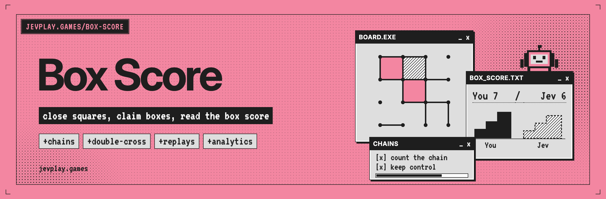
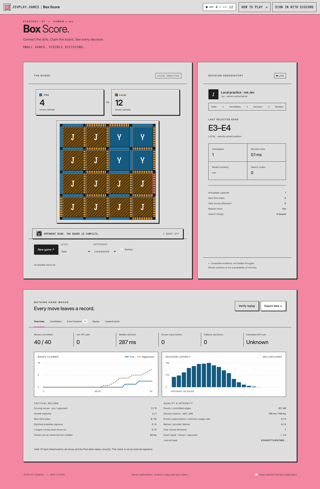
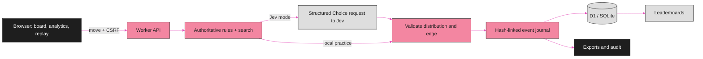

<p align="center"></p>

<div align="center">

# Box Score

**Claim boxes against a server-side Jev opponent, then read the box score: every move, candidate and decision on the record.**


[Quick start](#quick-start) · [How it works](#how-it-works) · [Analytics](#analytics) · [Export and audit](#export-and-audit) · [Tests and benchmarks](#tests-and-benchmarks) · [Discord and ranked play](#discord-and-ranked-play) · [Repository layout](#repository-layout) · [Contributing](#contributing)

</div>

---

Box Score is the classic connect-the-dots boxes game on a 4×4 board, played in one page against Jev, a server-side opponent. Its selling point is the stat sheet: each match keeps deterministic replays, hash-linked evidence for every decision and exports you can audit offline. It is part of [jevplay.games](https://jevplay.games).

> [!NOTE]
> **What is shipped and measured.** The game runs without credentials in clearly labeled local-practice mode; real Jev requests need a TypeSafe API key and Discord sign-in needs your own Discord application. The included tests use mocked external services, and the bundled benchmark is a 12-game local smoke run, not evidence of Jev's playing strength. See [Boundaries and limitations](#boundaries-and-limitations).

## Quick start

Install Node.js **22.13 or newer**, extract this folder, then run:

```sh
npm start
```

Open:

```text
http://127.0.0.1:8787
```

There are **no npm runtime dependencies** and no installation or build step for local play. The development server uses Node's built-in SQLite module and stores its database in `.data/game.sqlite`. Node may print an experimental SQLite warning on some 22.x versions.

Choose a difficulty and opponent, then click a line or **New game**. Capturing a box earns another move. All 40 edges and 16 boxes are played; 8–8 is a draw.

The localhost development server is not a public production server. For hosting, use the supplied Cloudflare Worker/D1 configuration and read [Deployment](docs/DEPLOYMENT.md).

### Enable Jev

Copy `.env.example` to `.env`:

```sh
# macOS / Linux
cp .env.example .env
```

```powershell
# Windows PowerShell
Copy-Item .env.example .env
```

Set these values in `.env`, then restart the server:

```dotenv
TYPESAFE_API_KEY=your_actual_key
JEV_MODEL=jev-1.13.0
```

Choose **Jev API** in the opponent selector. The server sends a structured Choice question over legal edges; the browser never receives the key. The returned distribution and selected edge are validated before a move is committed.

A provider failure is **not silently treated as Jev**: the match is demoted to local practice, the cause is recorded, and ranked eligibility is removed. The failure continues to appear in the analytics export.

The configured model is pinned. A model, prompt, search-profile or source-revision change creates a separate ranking cohort. Do not change the model/version environment underneath an unfinished ranked match.

## How it works

<p align="center"></p>



### What is included

| Area | Implemented behavior |
|---|---|
| Game | 4×4 boxes, both starting seats, double captures, extra moves, deterministic transitions |
| Interface | Responsive vanilla HTML/CSS/JS, keyboard edges, accessible move list, in-page rules |
| Opponents | Clearly labeled local practice; server-side Jev; Easy, Normal, Hard and Jev profiles |
| Decision evidence | Every legal candidate, tactical features, bounded search, selected edge, full valid probability distribution |
| Analytics | Live overview, score/latency charts, candidate inspector, expandable event timeline, metrics catalog |
| Replay | Scrubbing, playback, strict import, compact export, full evidence audit without provider calls |
| Identity | Discord authorization-code flow, identify scope, secure production session cookies, CSRF/origin checks |
| Communities | Signature-verified `/play` interaction, one-time user-bound launch code, recent guild/channel context |
| Rankings | World/Server/Channel, UTC month/all time, pinned-profile cohorts, seat-balanced score rates, shared ties, pagination |
| Integrity | Authoritative server moves, revision checks, idempotency, decision leases, replay verification, hash-linked evidence |
| Exports | Full JSON, JSONL journal, summary JSON, moves/decisions/candidates/attempts CSV, CLI batch export |
| Operations | Redacted API telemetry, opt-in client diagnostics, quotas, retention cleanup, administrative SQL queries |
| Research | Paired-seat benchmark, independent small-endgame solver tests, configuration provenance, exact-only regret |

## Analytics

The **Overview** displays actual recorded values, not prepopulated demonstration data. The **Candidates** tab lets you inspect any recorded opponent decision. The **Event timeline** exposes ordered event payloads. Exports retain more detail than the compact interface displays.

Recorded evidence includes:

- Pre/post-state hashes, actor, edge, captures, scores, extra-turn behavior and tactical board snapshots.
- Full legal candidate sets, capture opportunities, third-side creation, safe moves, components, search node budgets, cache hits, cutoffs and exactness.
- Jev request/state hashes, exact structured request, validated response, per-option probabilities, certainty, entropy, top-probability gap, selected action and decision source.
- Feature, provider, total-decision and commit timings; latency quantiles; request/response sizes; reported tokens; retries, timeouts and malformed-output failures.
- Versioned events, UTC timestamps, process-local monotonic clock domains, causal decision/request IDs, SHA-256 chaining and verification outcomes.
- Optional configured cost estimates with explicit unknown-usage and unknown-cost accounting.

See [Analytics definitions](docs/ANALYTICS.md), the machine-readable [metric catalog](docs/analytics-catalog.json), [event schema](docs/event.schema.json), and [administrative SQL](docs/analytics-queries.sql).

**Interpretation matters:** model certainty is not win probability. A cutoff estimate is not a solved final margin. Human elapsed time includes idle/network time. Exact regret remains null unless all alternatives were solved. Missing billing data is unknown, never assumed zero.

## Export and audit

Use **Export data** in the interface, or save a full match JSON and run:

```sh
npm run audit -- path/to/full-match.json
npm run export -- path/to/full-match.json analytics-export
```

The audit exits nonzero for invalid evidence. The export creates `summary.json`, `audit.json`, `manifest.json`, five CSV tables, corresponding JSONL tables, and the original hash-linked `journal.jsonl`.

A compact replay can be audited for rules consistency, but does not establish provider provenance. Imported replays can never create official leaderboard results.

For a local administrator's operational report:

```sh
node scripts/ops-export.mjs .data/game.sqlite operations-export
```

That export deliberately excludes user/session/OAuth tables.

## Tests and benchmarks

```sh
npm test
npm run benchmark -- --pairs 6 --mode local --opponent random --difficulty normal
```

The supplied Node test suite covers the engine, structured analytics, provider contract, retry/timeout behavior, API authorization, OAuth state binding, Discord signatures, concurrent requests, launch attribution, leaderboard isolation and pagination. It also enumerates every one-box move ordering for both starters and checks 1,000 seeded complete games.

The independent small-endgame oracle checks search values without relying on the search implementation's own evaluator.

For a live benchmark, explicitly select Jev:

```sh
npm run benchmark -- --pairs 20 --mode jev --opponent heuristic --difficulty normal
npm run benchmark -- --pairs 10 --mode jev --opponent jev --difficulty normal
```

Available baseline opponents: `random`, `greedy`, `heuristic`, `search`, `jev`. A live benchmark stops on provider failure rather than silently mixing fallback results into a Jev cohort. These commands incur provider usage when Jev is selected.

[Benchmark methodology](docs/BENCHMARKS.md) explains pairing, duplication risks and the limitations of the included small local smoke run.

### Browser tests

Browser testing is optional and separate from application dependencies:

```sh
python -m pip install playwright
python -m playwright install chromium
# In one terminal: npm start
# In another:
python scripts/browser-test.py
```

The packaging environment blocked browser navigation by administrative policy. Its recorded UI check therefore used `--embedded`: actual HTML/CSS/JS was loaded into a browser document, HTTP was bridged to the real local API, and game interactions were exercised. **This does not validate normal navigation, CSP enforcement, native cookie handling, OAuth redirects or downloads.** The normal test path is included for an unrestricted development machine.

See [Validation record](docs/VALIDATION.md). Screenshots are from the actual implemented interface, not an image-generation mockup.

## Discord and ranked play

Read [Deployment](docs/DEPLOYMENT.md) for the exact application settings, OAuth callback, interaction endpoint and command registration.

Ranked games require Discord authentication and Jev API mode. Starting seats alternate. World rankings contain all eligible ranked matches; server/channel rankings contain only matches launched through verified context. Client-supplied guild/channel IDs are ignored.

Each launch code is valid for ten minutes and one match. Recent community context is also time-limited; relaunch from Discord to refresh access. This is not continuous membership verification.

A rank requires ten settled games in each starting seat. The ranking metric is:

```text
0.5 × [(wins + 0.5 × draws) / games when human starts]
+ 0.5 × [(wins + 0.5 × draws) / games when Jev starts]
```

Concessions count as losses while preserving actual partial board scores. Confirmed provider failures remove eligibility. Practice results do not become official retroactively. Equal score rates share the same rank.

## Repository layout

```text
public/                 Single-page interface, shared brand files and rules/analytics
  games/box-score/      Pure deterministic rules and search (shared by browser and Worker)
src/                    Web-standard Worker API, Jev, OAuth, Discord, matches
migrations/             SQLite / D1 schema and indexes
scripts/                Local server, SQLite adapter, audit/export/browser tools
bench/                  Reproducible paired evaluation runner
tests/                  Node tests and mock-service fixtures
docs/                   Architecture, security, analytics and deployment
reports/                Executed test output, local benchmark evidence, screenshots
```

### Boundaries and limitations

This is a runnable implementation, not a claim of independently audited production security or proven Jev playing strength. Real TypeSafe inference, real Discord consent/interactions, and a Cloudflare deployment were not exercised during packaging. Search-assisted modes can require substantially more CPU than Easy/Normal; do not assume a free serverless tier is sufficient.

The hash chain detects changed evidence relative to a retained head; it is not an external signature or immutable public ledger. A database administrator capable of rewriting the entire chain is outside that guarantee. No lightweight browser game can prove the absence of external human solver assistance.

Required deployment configuration is deliberately left explicit rather than replaced with working credentials or fabricated service connections.

## Contributing

Issues and pull requests are welcome. Run `npm test` before opening a pull request, keep the rules in `public/games/box-score/` free of DOM and I/O, and do not change stored identifiers (replay format, match format, rules version, the model-facing game id) without a version bump: replays exported before the Box Score rename (game id `dots-and-boxes`) must keep importing. Licensed under the [MIT License](LICENSE).

<p align="center">
<sub>A jevplay.games game · Steward: CompleteTech LLC · MIT licensed<br>
Not an official TypeSafe AI publication; the pink, ink and pixel-window styling is a nod to <a href="https://typesafe.ai">typesafe.ai</a>. Jev, System One and TypeSafe are their respective owners' names.</sub>
</p>
